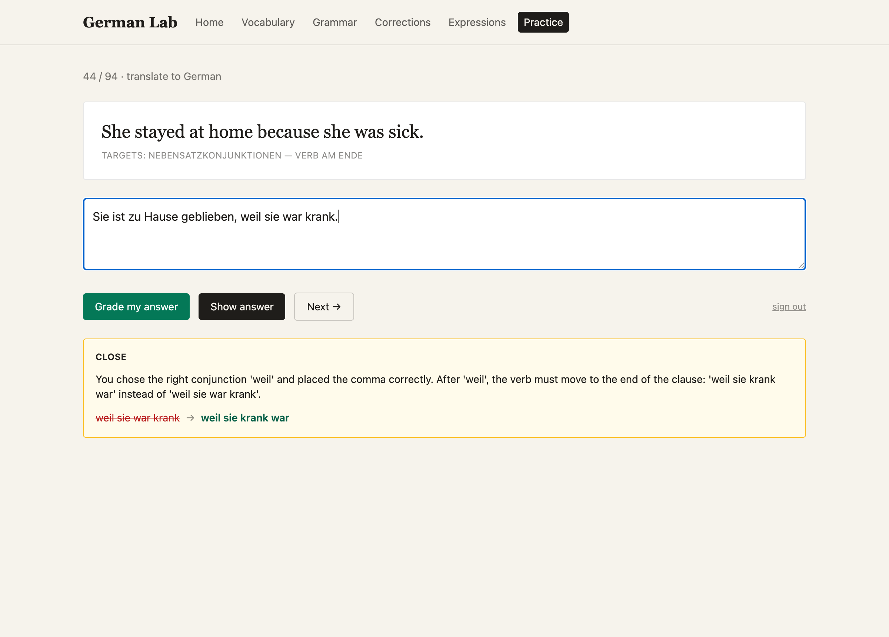
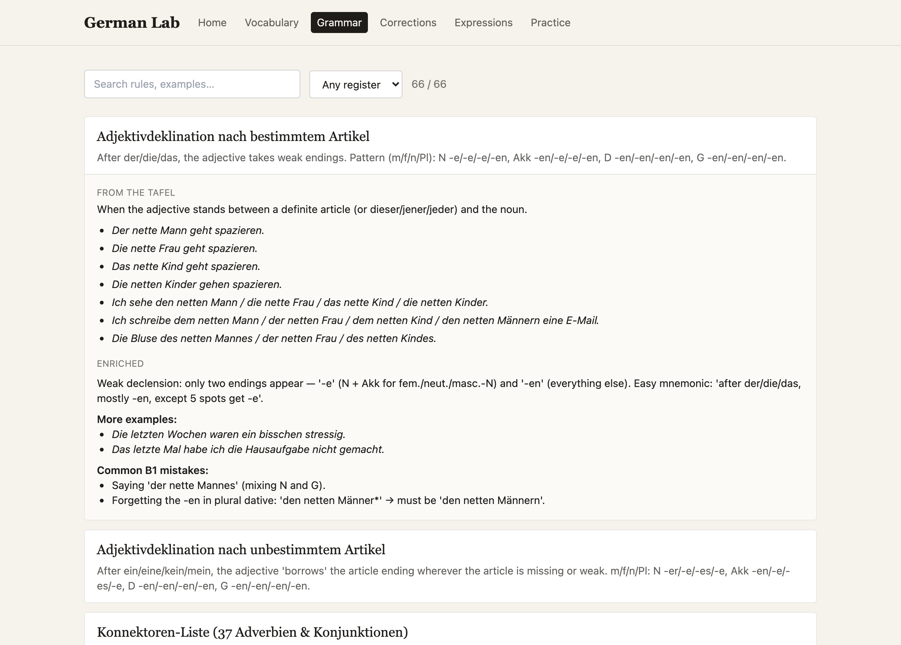
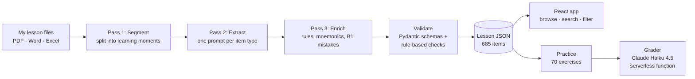

# German Lab: a German tutor built from my own lessons

**German Lab** is a personalised German tutor built on an LLM pipeline. It ingests my own lesson
documents (PDF whiteboard notes, Word files, an Excel workbook) and turns them into a knowledge base
of **685 schema-validated items** through multi-pass extraction: segmentation, typed extraction and
enrichment, with Pydantic validation and rule-based quality checks. From that knowledge base it builds
translation drills on the grammar rules my teacher taught and the mistakes I made.

An **LLM grader** (Claude Haiku 4.5, structured JSON output) scores every answer. It is grounded by
**retrieval**: each exercise pulls its source rule, my teacher's example sentences and the typical B1
mistakes for that rule from the knowledge base, by ID. The grader is measured with an **evaluation
harness**: a gold set labelled blind by an **LLM-as-judge**, two **held-out test sets**, and repeated
runs to separate real changes from noise.

Duolingo and Babbel give every learner the same exercises. German Lab only knows what happened in
my lessons, and that is the point.

  
  &nbsp;
  

I am the AI product manager and designer: I own the pipeline design, the evaluation and every
product decision. This repository tells the story of the product and its AI system. The app's code
and my lesson data are private.

---

## The goal

I am a B1 German learner working towards business German. My lessons produce a lot of material,
but it is unusable for practice:

- My teacher writes on a digital whiteboard during the lesson. Corrections of my sentences, new
  words, grammar rules and homework all end up on the same page, with no titles and no structure.
- My own vocabulary lives in Word files and an Excel workbook with seven sheets.

I wanted one place that turns all of this into practice, without me retyping anything, and that
drills **my** weak points instead of generic ones.

## What goes in: my own documents

| Document | Format | What it holds |
|---|---|---|
| Teacher's whiteboard notes, exported per lesson period | PDF | Corrections of my sentences, grammar rules, new words, homework, all mixed |
| My vocabulary notes | Word (.docx), 2 files | Words, expressions, example sentences |
| My vocabulary workbook | Excel (.xlsx), 7 sheets | Connectors, adjectives, verbs, nouns, expressions, news vocabulary, nature |

There is no upload button. When I have a new lesson, I drop the file into the project and run the
extraction in a Claude Code session. Text PDFs work; scanned pages would need text recognition first.

## What comes out: a knowledge base of my own learning

| | |
|---|---|
| Source documents | 4 files, split into 14 lessons |
| Items extracted | **685**: 518 words, 73 expressions, 66 grammar rules, 26 corrections, 2 homework tasks |
| Translation exercises | 70, each tied to one of my teacher's rules or one of my own mistakes |
| Running cost | extraction $0 · hosting $0 · about **0.2 cents** per graded answer |

## How it is personalised

- **Every item comes from my lessons.** Nothing is imported from a generic word list.
- **The 26 corrections are my own mistakes**, as my teacher corrected them, with the rule behind each one.
- **The exercises target my teacher's rules and my mistakes.** "I like it very much" exists as an
  exercise because I once wrote *"Ich mag es viel"* in class.
- **The grader knows what the exercise is for.** It is told which of my teacher's rules the sentence
  practises and, for grammar rules, her own example sentences and the typical B1 mistakes for that rule.
- **Business German has its own filter.** Every item carries a register (business, formal, informal,
  neutral), because business German is my goal.
- **I can add my own words** in the app as I meet them.

## Architecture

**Stack:** React + Vite + TypeScript + Tailwind · Vercel (static site + one serverless function) ·
Python + Pydantic for extraction · Claude (extraction in Claude Code sessions, grading via the API).

## 1. Extraction: from messy notes to typed items

The whiteboard notes are the hard part. A correction can appear as `✗ … / ✓ …`, as `nein → …`, as
crossed-out text, or as two sentences side by side with no marker at all. One prompt that does
everything at once misses too much, so extraction runs in three passes:

1. **Segment:** split the raw text into learning moments, copied verbatim, with a first guess at the
   type. No cleaning, no translation.
2. **Extract:** send each moment to a prompt for its type (word, correction, grammar rule,
   expression, homework) that fills a typed record.
3. **Enrich:** add context the teacher did not write: the full rule, exceptions, memory aids,
   collocations, typical B1 mistakes.

**My teacher's words and the AI's additions are kept apart.** Every item has a `from_tafel` section
(what the teacher literally wrote) and an `enriched` section (what the model added). The app shows the
teacher's content first and the AI's additions in a separate, labelled section, so I always know which is which.

**I do not trust the model's own confidence.** Every item is validated against a Pydantic schema, and
rule-based checks (for example: is the "German" example actually German?) mark doubtful items as
needing review instead of silently trusting them.

## 2. Practice: exercises from my own rules and mistakes

Each exercise is an English sentence to translate, written ahead of time for one of my teacher's
rules or one of my corrections. Writing them in advance keeps the only paid AI call at runtime to the
grading itself.

The grader returns a fixed structure: a score (**correct**, **close** or **wrong**), a short
explanation, and a list of mistakes with their fixes. German allows several correct translations,
so string matching is useless here; the grader has to judge the German itself.

## 3. Evaluating the grader

A grader that tells me a correct sentence is wrong teaches me the wrong thing. So before changing it,
I measured it. I used two methods from my ETH Zurich studies (MAS in Applied Information and Data
Science): a **gold set** and **LLM-as-judge**.

**Setup**

- **Gold labels from a stronger model:** a Claude Opus agent, told to act as an experienced German
  examiner, labelled every case **blind**: it never saw the intended labels, the grader's prompt or
  its output. I chose this over a teacher for speed; the limits are listed below.
- **Three sets:**
  - a **development set** of 45 cases, used to tune the grader;
  - **held-out set 1**, 30 cases written by a separate agent that never saw the development set or
    the grader;
  - **held-out set 2**, 30 more cases written the same way and used once, after all changes.
- **Every version runs at least three times on every set**, because the same prompt on the same cases varied
  by up to 11 points between runs. A single run would have misled me.

**Results** (agreement with the gold labels, average of 3–4 runs)

| Version | What changed | Dev set (45) | Held-out 1 (30) | Held-out 2 (30, clean) | Correct ↔ wrong mix-ups |
|---|---|---|---|---|---|
| v1 | first prompt | 81% | 59% | 52% | 2 in 10 runs |
| v2 | sharper scoring rules | 84% | 58% | not run | 3 in 6 runs |
| v3 | works out the mistakes before it scores | **91%** | 71%\* | 47% | **0 in 10 runs** |

\* I had looked at the held-out 1 failures before building v3, so that number is not clean.

**What happened**

- **v2 looked better and was not shipped.** It gained 4 points on the set it was tuned on, lost them on
  new cases, and graded a perfect sentence ("Wenn du Zeit hast, ruf mich an.") as wrong in every run.
- **v3 changed the structure, not the wording.** v1 and v2 wrote the score first and the explanation
  after, so the model committed to a score before it had found the mistakes. v3 writes the corrected
  sentence and the list of mistakes first, and the score last.
- **The clean test brought the number down to earth.** v3 went from 91% on the development set to 47%
  on cases nobody had seen. On clean data, v1 and v3 are within the noise of each other. I kept v3
  live because in 10 runs it never called a correct answer wrong or a wrong answer correct.

**What the grader still gets wrong**

- **It is too mild with broken sentences.** About four in five answers the judge scores "wrong" come
  back as "close".
- **It misses real grammar mistakes**, for example *"Welche Sprache sprechst du?"* (should be
  *sprichst*) or *"Der Preis hat gestiegen"* (should be *ist gestiegen*). No prompt teaches a model
  grammar it does not know, so the next lever is the model, not the prompt.

**Limits of this evaluation**

- The gold labels come from an AI model, not a teacher. A model judging a model can share its blind spots.
- The sets are small: with 30 cases, each number is uncertain by roughly ±9 points.
- The evaluation scores the grade, not the explanation. Some explanations were wrong even when the
  grade was fine.
- The evaluation also exposed a data problem: 24 of the 94 generated exercises, the ones built from
  my Excel vocabulary lists, were unusable. They are excluded and will be regenerated.

## 4. Cost as a design constraint

- **Extraction costs nothing:** it runs inside Claude Code sessions on my existing Claude plan.
- **Hosting costs nothing:** a static site plus one serverless function on Vercel's free tier.
- **Grading is the only paid call:** Claude Haiku 4.5, about 0.2 cents per answer. A full
  evaluation run of 45 cases costs under 10 cents.
- **The grading endpoint is protected:** a password, a rate limit per visitor, and the API key only
  on the server.

## Design decisions

- **Keyed retrieval, not vector search (no RAG).** 685 items fit in less than 1 MB, and each exercise
  is linked to its rule by ID, so the grader gets exactly the right teacher examples by direct lookup.
  Embeddings and a search index would add cost and complexity and make the lookup less exact.
- **Teacher content and AI content stay separate**, so I never mistake a model's addition for what
  my teacher said.
- **Rule-based checks over model confidence**, because a model's stated confidence is not calibrated.
- **Measure before changing**, and keep a test set nobody tuned on.

## What I learned

- **A score on data you have seen is not a score.** 91% on the development set became 47% on clean
  data. The held-out set was the most valuable thing I built.
- **Run it more than once.** The same prompt moved 11 points between runs.
- **Fix the structure before the wording.** Making the model find the mistakes before it scores did
  more than any new rule.
- **Know when the model is the limit.** Once the prompt is clear, missing grammar knowledge is a
  model problem.
- **Do not ship a version just because it looks better.** v2 had the better development score and the
  worse behaviour.

## What is next

- Test a stronger grader model on the same three sets.
- Spaced-repetition flashcards for the 518 words.
- Regenerate the 24 broken exercises.

---

*AI product manager and designer: Daniela Muc.*
